# README IS A WORK IN PROGRESS!!

# Design Patterns in Java

Instead of just reading about each pattern, I wanted to actually sit down and implement all of them in Java. The goal was to get a 
better feel for how each pattern works, what problem it's trying to solve, and what the implementation actually looks like in practice.

Each pattern has its own implementation using standard Java classes and interfaces, with no additional frameworks or libraries.

## Patterns Covered

The repository includes implementations of all 23 classic GoF patterns across three categories:

- Creational Patterns — 5 patterns

- Structural Patterns — 7 patterns

- Behavioral Patterns — 11 patterns

This repository is primarily a learning exercise and a reference for revisiting design patterns through working code.

# UML Diagrams

I've also put together UML diagrams for each pattern implementation.

The idea here is to have both the code and the conceptual view of each implementation readily available. 
The Java code shows the actual implementation, while the UML diagrams make it easier to see how the pieces fit together 
and how the pattern is structured.

## Creational Patterns
 Patterns that focus on streamlining the object creation portion of programming, giving you more 
 flexibility in how objects come into existence.
### Abstract Factory
- Purpose/intent: Pattern that provides an interface for creating families of related/dependent objects w/o specifying 
their concrete class.
- Ideal usage: When you are constantly creating multiple related objects that need to work together.
 
  | Pros                                                                                |                                                                           Cons |
  |:------------------------------------------------------------------------------------|-------------------------------------------------------------------------------:|
  | Promotes consistency, since objects made with factory are compatible and consistent |                                                      Increased code complexity |
  | Separates creation logic from main code                                             |   Limited use scope, best suited for specific sets of related families/objects |
  | Increases code flexibility and scalability                                          |                                                                                |
  | Promotes loose coupling                                                             |                                                                                |

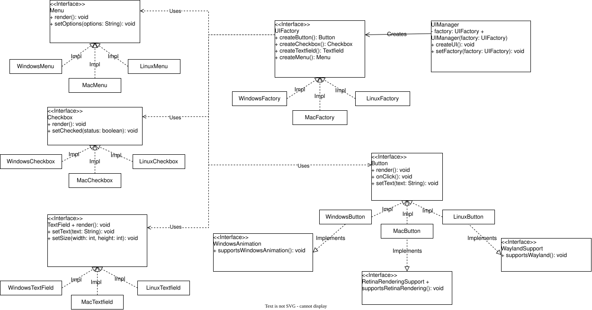

### Builder
- Purpose/intent: Pattern that separates the construction process of a complex object from its representation, 
allowing different variations of an objects to be made from the same construction process.
- Ideal usage: When constructing and object requires a lot of parameters and many are optional.

| Pros                                           |                                                                           Cons |
|:-----------------------------------------------|-------------------------------------------------------------------------------:|
| Promotes separation of object creation and use |                                                      Increased code complexity |
| Enhanced object configurability                | Potential for inconsistency because of the flexibility of the building process |
| Improved code readability                      |                                                                                |

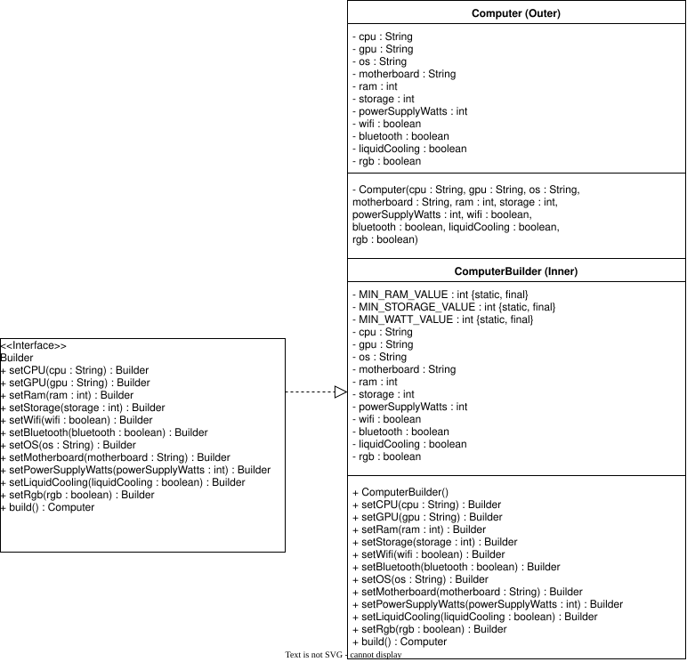

### Factory Method
- Purpose/intent: Pattern that allows you to create objects using a superclass, this superclass delegates object 
creation to its subclasses.
- Ideal usage: When you need an object but don't want the code requesting it to be tightly coupled with a specific 
implementation of that object.

| Pros                                                                         |                                                                    Cons |
|:-----------------------------------------------------------------------------|------------------------------------------------------------------------:|
| Gives flexibility to introduce new types of products w/o much code changes   |                                               Increased code complexity |
| Provides weak coupling/loose coupling of components                          | Can lead to code duplication if logic of implementations is too similar |
| Separates object creation from the rest of the code so its more maintainable |                                                                         |

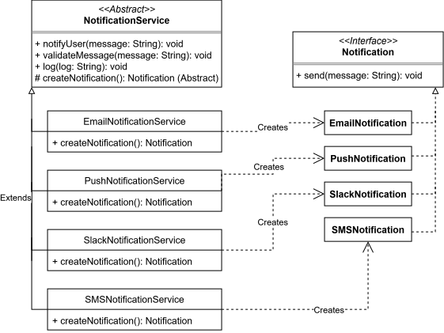

### Prototype
- Purpose/intent: Pattern that allows you to create new objects by copying/cloning existing objects.
- Ideal usage: Use when object creation is resource intensive or unconventional and another object can serve as a 
template when cloned.

| Pros                                                                                                    |                             Cons |
|:--------------------------------------------------------------------------------------------------------|---------------------------------:|
| Can reduce the overhead that comes from creating and initializing objects from scratch                  |        Increased code complexity |
| Flexibility of cloning allows for more agile development environments, because you can clone on the fly | Can create circular dependencies |

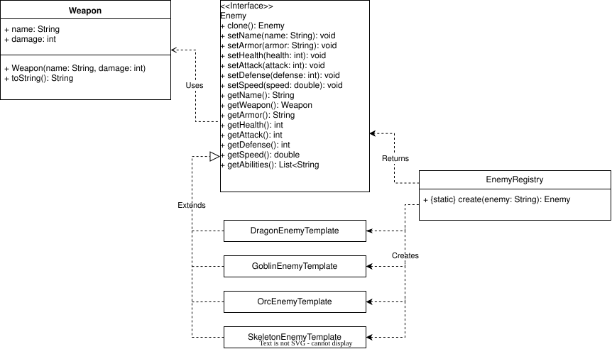

### Singleton
- Purpose/intent: Pattern ensures class has only 1 instance and provides a global access point to itself.
- Ideal usage: When it makes logical sense for there to be one instance of something 
(i.e. "will having two of these cause problems?").

| Pros                                                      |                                                                       Cons |
|:----------------------------------------------------------|---------------------------------------------------------------------------:|
| Provides a single well defined entry point to an instance |                                          Testing may require complex setup |
| Excels at resource & state management                     |                     Pattern can get complex in multi-threaded environments |
| Allows for lazy initialization of resources               | Often seen as an 'anti-pattern' because it tends to add complexity to code |

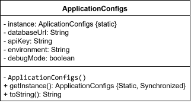

## Structural Patterns
 Patterns that deal with how classes & objects are structured. 
 Blueprints for building larger structure from individual parts.

### Adapter
- Purpose/intent: Pattern that allows objects w/ incompatible interfaces to work together by providing a bridge
between them, this bridge being the adapter.
- Ideal usage: Adapting 2 existing incompatible interfaces.

| Pros                                                                           |                                    Cons |
|:-------------------------------------------------------------------------------|----------------------------------------:|
| Allows different interfaces to work together, ensuring effective communication |               Increased code complexity |
| Encourages separation of concerns                                              |  Can take longer to maintain/understand |
| Often used to integrate legacy code                                            | Adapters can add a performance overhead |
|                                                                                |                     Limited flexibility |

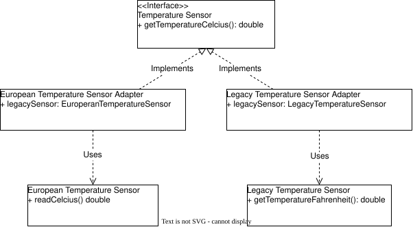
### Bridge
- Purpose/intent: Pattern that separates abstraction from implementation, allowing them to evolve independently. 
It decouples the implementation and abstraction.
  - Implementation (as used in this pattern): class/interface that does the low-level work.
  - abstraction (as used in this pattern): high-level control layer that does work using the implementation 
  level class/interface.
- Ideal usage: When you have dimensions that need to work together while still evolving independently.

| Pros                          |                      Cons |
|:------------------------------|--------------------------:|
| Offers significant decoupling | Increased code complexity |
| Facilitated extension         |                           |

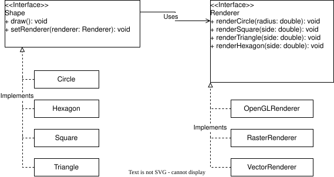

### Composite
- Purpose/intent: Pattern that combines objects into a tree structure to represent part-whole hierarchies, allowing
objects/object compositions to be handled uniformly.
    - part-whole = complex objects (whole) composed of simpler parts (part).
- Ideal usage: When one desires uniform treatment of part-whole objects.

| Pros                                                                                             |                                                                                                             Cons |
|:-------------------------------------------------------------------------------------------------|-----------------------------------------------------------------------------------------------------------------:|
| Offers a unified interface                                                                       |                                                                                        Increased code complexity |
| Recursive structure is good for representing complex hierarchies in a clean and organized manner | Can have s big performance overhead, since in the worse case scenario you traverse the whole tree-like structure |
| Very flexible                                                                                    |                                                                 Complexity is not worth it for simpler scenarios |

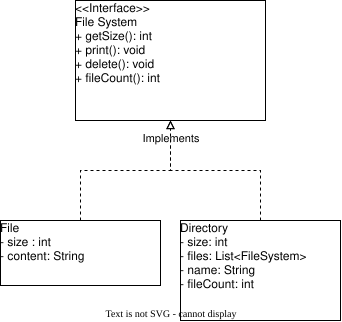

### Decorator
- Purpose/intent: Pattern that allows you to dynamically add behaviors/responsibilities to objects without changing 
their code
- Ideal usage: When an object has composable or mix-and-match additional responsibilities.

| Pros                                         |                                                                             Cons |
|:---------------------------------------------|---------------------------------------------------------------------------------:|
| Adheres to the open/close principle          |                                                        Increased code complexity |
| Provides flexible behavior extensions        | Order of wrapping matters, since depending on the order the end results may vary |
| Encourages modularity/separation of concerns |                                                                                  |

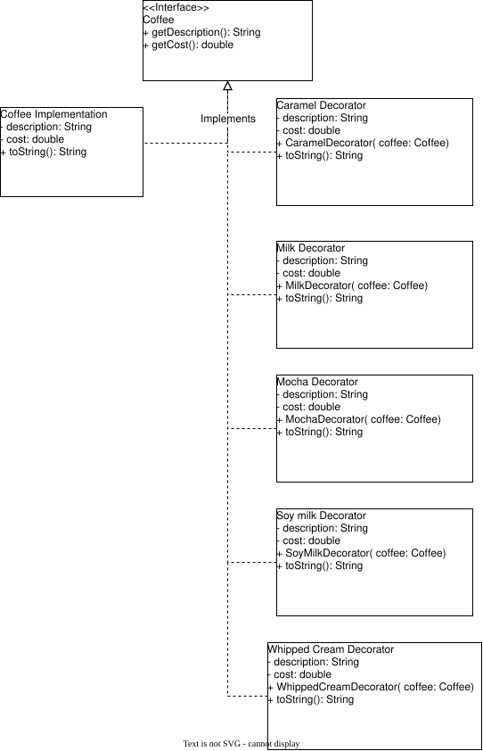

### Facade
- Purpose/intent: Pattern that provides a unified interface to a set of interfaces in a subsystem
  Ideal usage: When you need a simplifies interface for a subsystem/s

  | Pros                                                              |                                                                                                                Cons |
  |:------------------------------------------------------------------|--------------------------------------------------------------------------------------------------------------------:|
  | Simplifies usage of a subsystem by providing a single entry point | Reduced flexibility, since facade makes it challenging to modify/expand subsystem without also modifying the facade |
  | Encourages separation between client and subsystem classes        |                                                                                     Can lead to a bloated interface |
  | Offers a way to organize code cleanly                             |                                                                                                                     |

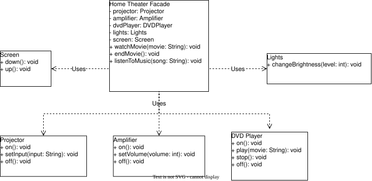

### Flyweight
- Purpose/intent: Pattern that focused on efficient sharing & reusing object state 
- Ideal usage: When one wants to improve memory and states that can be shared by multiple objects exist

  | Pros                                      |                                          Cons |
  |:------------------------------------------|----------------------------------------------:|
  | Improves memeory efficiency & performance |                     Increased code complexity |
  | Aids in resource management               |                           Reduced Flexibility |
  |                                           | Sharing vs Duplication decisions are critical |

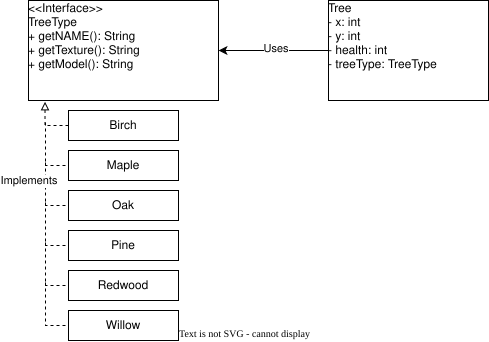

### Proxy
- Purpose/intent: Pattern that provides a placeholder for another object, mainly controlling the access to said object
- Ideal usage: When one wants a stand-in object that can provide access control and/or additional behaviors

  | Pros                                    |                                                Cons |
  |:----------------------------------------|----------------------------------------------------:|
  | Enhances access controls                |                           Increased code complexity |
  | Aids in inefficient resource management | Adds overhead because of extra layer of redirection |
  | Can optimize system performance         |                                                     |
  | Simplifies client code                  |                                                     |

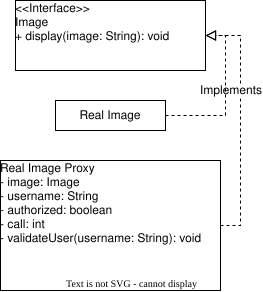

## Behavioral Patterns

This group of patterns focus mainly on how objects communicate/interact and distribute responsibility with each other

### Chain of Responsibility
- Purpose/intent: Pattern that allows you to create a chain of objects, where each object can either handle a request 
or pass it along to the next object
- Ideal usage: Use when you have multiple possible handlers for a request

  | Pros                           |                                        Cons |
  |:-------------------------------|--------------------------------------------:|
  | Decouples sender and receiver  |                               Order Matters |
  | Very flexible                  |               Requests could go unprocessed |
  | Suits changing requirements    | Comes with significant performance overhead |
  | Enforces single responsibility |                                             |

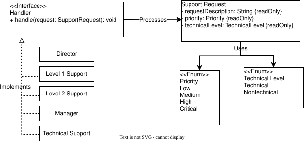
### Command
- Purpose/intent: Pattern that turns a request into a standalone object containing all the request information
- Ideal usage: When one wants to turn an action into an object

  | Pros                          |                      Cons |
  |:------------------------------|--------------------------:|
  | Offers significant decoupling | Increased code complexity |
  | Supports undo/redo            |                           |

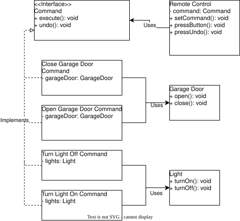
### Interpreter
- Purpose/intent: Pattern that provides a way to evaluate sentences/expression in a language; interpreter defines
a language and its grammar in terms of a set of classes
- Ideal usage: When one needs to evaluate a small/simple language or grammar

  | Pros                        |                       Cons |
  |:----------------------------|---------------------------:|
  | Modular                     | Very limited applicability |
  | System ca be very extensive |                            |

- Due to this pattern's very niche use case, I decided to skip implementing it.

### Iterator
- Purpose/intent: Patterb that provides a way to access elements of a collection without exposing its underlying 
representation
- Ideal usage: When you need to traverse a collection in a way that doesn't expose the underlying implementations

  | Pros                                              |                      Cons |
  |:--------------------------------------------------|--------------------------:|
  | Decouples the traversal from the collection       | Increased code complexity |
  | Provides a uniform interface                      |     Limited functionality |
  | Can handle iterating over complex data structures |                           |

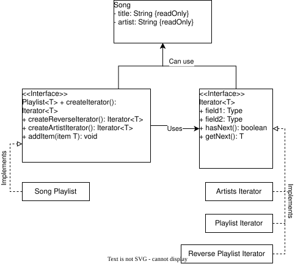
### Mediator
- Purpose/intent:
- Ideal usage:

[//]: # ()
[//]: # (  | Pros                          |                      Cons |)

[//]: # (    |:------------------------------|--------------------------:|)

[//]: # (  | Offers significant decoupling | Increased code complexity |)

[//]: # (  | Facilitated extension         |                           |)

[//]: # ()
[//]: # (![Facade UML Diagram]&#40;Assets/Facade.svg&#41;)
### Memento
- Purpose/intent:
- Ideal usage:

[//]: # ()
[//]: # (  | Pros                          |                      Cons |)

[//]: # (    |:------------------------------|--------------------------:|)

[//]: # (  | Offers significant decoupling | Increased code complexity |)

[//]: # (  | Facilitated extension         |                           |)

[//]: # ()
[//]: # (![Facade UML Diagram]&#40;Assets/Facade.svg&#41;)
### Observer
- Purpose/intent:
- Ideal usage:

[//]: # ()
[//]: # (  | Pros                          |                      Cons |)

[//]: # (    |:------------------------------|--------------------------:|)

[//]: # (  | Offers significant decoupling | Increased code complexity |)

[//]: # (  | Facilitated extension         |                           |)

[//]: # ()
[//]: # (![Facade UML Diagram]&#40;Assets/Facade.svg&#41;)
### State
- Purpose/intent:
- Ideal usage:

[//]: # ()
[//]: # (  | Pros                          |                      Cons |)

[//]: # (    |:------------------------------|--------------------------:|)

[//]: # (  | Offers significant decoupling | Increased code complexity |)

[//]: # (  | Facilitated extension         |                           |)

[//]: # ()
[//]: # (![Facade UML Diagram]&#40;Assets/Facade.svg&#41;)
### Strategy
- Purpose/intent:
- Ideal usage:

[//]: # ()
[//]: # (  | Pros                          |                      Cons |)

[//]: # (    |:------------------------------|--------------------------:|)

[//]: # (  | Offers significant decoupling | Increased code complexity |)

[//]: # (  | Facilitated extension         |                           |)

[//]: # ()
[//]: # (![Facade UML Diagram]&#40;Assets/Facade.svg&#41;)
### Template Method
- Purpose/intent:
- Ideal usage:

[//]: # ()
[//]: # (  | Pros                          |                      Cons |)

[//]: # (    |:------------------------------|--------------------------:|)

[//]: # (  | Offers significant decoupling | Increased code complexity |)

[//]: # (  | Facilitated extension         |                           |)

[//]: # ()
[//]: # (![Facade UML Diagram]&#40;Assets/Facade.svg&#41;)
### Visitor
- Purpose/intent:
- Ideal usage:

[//]: # ()
[//]: # (  | Pros                          |                      Cons |)

[//]: # (    |:------------------------------|--------------------------:|)

[//]: # (  | Offers significant decoupling | Increased code complexity |)

[//]: # (  | Facilitated extension         |                           |)

[//]: # ()
[//]: # (![Facade UML Diagram]&#40;Assets/Facade.svg&#41;)

# What I Learned
Implementing these patterns helped me understand a lot more about why architecture and planning matter when building software.

One of the biggest things I took away from this project was becoming much more comfortable with interfaces and with understanding 
code that someone else has written. Before starting this project, I remember coming across the Builder pattern in a library I use 
in one of my main projects, Clarity API, and being utterly confused about why I had to instantiate an object through a series of 
method calls instead of just using a constructor. After learning and implementing the pattern myself, that same kind of code makes a 
lot more sense.

Working through all 23 patterns has also broadened the way I think about programming. I have a better understanding now of how patterns 
can provide a kind of blueprint for structuring code, and how that structure can make software more flexible, scalable, and maintainable.

Something else I didn't really appreciate before this project was how much design patterns can improve the development experience. 
When you come across code that follows a pattern you recognize, you don't have to spend as much time figuring out the overall structure 
before you can start understanding the actual logic.

Overall, this project gave me a better appreciation for programming as more than just writing code that works. There's also a lot of 
thought that goes into how that code is organized, how easy it is for someone else to understand, and how well it can adapt as a project grows.

# How I Learned

I wanted this learning process to be more than just following along with examples, so I used a few different resources 
throughout the process, with each one serving a different purpose.

YouTube — I used videos to learn the theory behind each design pattern and get a general understanding of what problem 
each pattern is trying to solve.

AI — Once I had a basic understanding of a pattern, I used AI to give me exercises and scenarios to implement myself 
(can be found in the main class of each design pattern as a comment at the start of the main file). This gave me a way 
to actually practice the patterns instead of just reading about them.

Design Patterns: Elements of Reusable Object-Oriented Software — I also have the original Gang of Four (GoF) book, 
which I plan to read as I continue learning. My goal is to use it to go deeper into the ideas behind the patterns and 
better understand the reasoning that led to them.

Another tough lesson I've learned recently:

I thought I could skip the LeetCode grinding phase.

When I started teaching myself after graduation, I wanted to focus on learning skills that are actually used in the 
industry. I wanted to understand how applications are built, how APIs work, how databases fit into the picture, and 
how to put all of those pieces together; You know, learn what it takes to develop real 
applications.

I figured that if I focused enough on becoming a better developer, I'd be able to avoid spending countless hours 
solving algorithm problems. Since you know, I didn't particularly want to spend months grinding algorithm problems.

Well, after yet another failed technical assessment, I've come to realize that there probably isn't any skipping this 
phase.

As much as I might not enjoy the idea of grinding LeetCode problems, they serve as somewhat of a secret handshake in 
the industry.

Being able to solve these problems at a certain level demonstrates a baseline understanding of data structures and 
algorithms. It also shows that you've put in the time to understand these concepts and apply them to unfamiliar problems.

And whether I agree with how heavily they're emphasized in technical interviews or not, they're clearly something 
I need to get better at.

Like it or not, it's a part of the process.

So, Clarity is going to have to take a bit of a backseat for now.

It's time to start my LeetCode grinding journey.

Hopefully, I'll come out on the other side not only better prepared for technical assessments, but also a better 
programmer.

Another lesson learned. Hopefully, future me will appreciate the effort.

#LeetCode #DataStructuresAndAlgorithms #SoftwareEngineering #CareerGrowth #LearningInPublic
